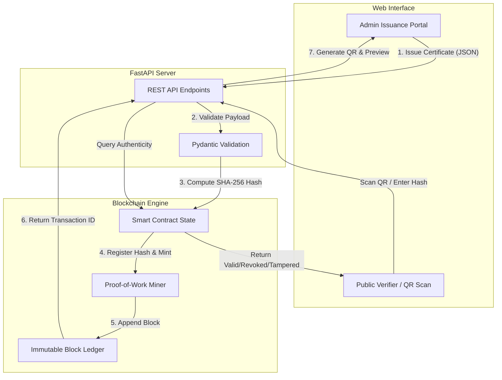

# EduChain Authenticator 🎓⛓️


**EduChain Authenticator** is a decentralized, blockchain-backed academic certificate issuance and verification system. It aims to eliminate certificate forgery and enable instant, tamper-proof verification for universities, employers, and students.

---

## 📖 Table of Contents
- [Problem Statement](#problem-statement)
- [Features](#features)
- [System Architecture](#system-architecture)
- [Getting Started](#getting-started)
- [API Documentation](#api-documentation)
- [Tamper Simulation Sandbox](#tamper-simulation-sandbox)
- [Contributing](#contributing)
- [License](#license)

---

## ⚠️ Problem Statement
Traditional paper and basic PDF certificates are highly susceptible to forgery, altered grades, and fraudulent credential claims. Background checks and manual verification processes take weeks and cost institutions heavily.

**Solution:** EduChain cryptographically registers academic certificates on an immutable blockchain ledger using **SHA-256 hashes**. Any attempt to alter historical data breaks the hash chain, immediately invalidating the fraudulent certificate.

---

## ✨ Features
1. **Student Certificate Registration:** Authorized universities can mint new certificates containing student details and grades directly to the blockchain.
2. **SHA-256 Hash Generation:** Employs canonical JSON serialization to compute a unique, cryptographic digest for every certificate.
3. **Immutable Blockchain Storage:** A local Emulated EVM state engine that enforces Proof-of-Work and maintains an unalterable block index.
4. **Instant Verification via QR:** Dynamically generated QR codes embed deep-link URLs to verify a certificate's authenticity instantly.
5. **Tamper-Proof Sandbox:** An interactive UI to simulate fraud and demonstrate how altering a single character (e.g., GPA) breaks the cryptographic signature.

---

## 🏗️ System Architecture
- **Backend:** Python (FastAPI) handling HTTP requests and RESTful endpoints.
- **Blockchain Engine:** Custom Python implementation replicating core Web3 concepts (Block hashing, Nonce, Smart Contract State).
- **Frontend:** HTML5, Tailwind CSS, JavaScript (Vanilla), and Canvas Confetti for an elegant responsive UI.

### Flow Diagram



---

## 🚀 Getting Started

### Prerequisites
- Python 3.10+
- `uv` (optional, for lightning-fast package management)
- Docker (optional, for containerized deployment)

### Installation Options

First, clone the repository and navigate into the directory:
```bash
git clone https://github.com/yourusername/educhain-authenticator.git
cd educhain-authenticator
```

#### Option 1: Standard Python `venv`
```bash
# Create and activate a virtual environment
python -m venv venv
source venv/bin/activate  # On Windows use: venv\Scripts\activate

# Install dependencies
pip install -r requirements.txt

# Run the development server
python -m uvicorn main:app --host 0.0.0.0 --port 8000 --reload
```

#### Option 2: Using `uv` (Ultra-Fast)
```bash
# Create a virtual environment using uv
uv venv
source .venv/bin/activate  # On Windows use: .venv\Scripts\activate

# Install dependencies blazingly fast
uv pip install -r requirements.txt

# Run the development server
python -m uvicorn main:app --host 0.0.0.0 --port 8000 --reload
```

#### Option 3: Docker (Production-Ready)
```bash
# Build the Docker image
docker build -t educhain-authenticator .

# Run the container
docker run -d -p 8000:8000 --name educhain-app educhain-authenticator
```

### Access the Application
Once the server is running (via any of the methods above), open your browser and navigate to [http://localhost:8000](http://localhost:8000).

---

## 🧪 Running Tests
The project uses `pytest` for unit testing the blockchain mechanics, tamper detection, and smart contract state.

```bash
python -m pytest tests/
```

---

## 📡 API Documentation
Once the server is running, FastAPI automatically generates interactive API documentation.
- **Swagger UI:** [http://localhost:8000/docs](http://localhost:8000/docs)
- **ReDoc:** [http://localhost:8000/redoc](http://localhost:8000/redoc)

### Core Endpoints:
- `POST /api/issue` - Mint a new certificate block.
- `GET /api/verify/{cert_hash}` - Query the ledger for a hash.
- `POST /api/revoke` - Revoke an existing certificate.
- `GET /api/ledger` - Fetch the entire blockchain history.
- `POST /api/tamper` - Test payload manipulation (Sandbox).

---

## 🛡️ Tamper Simulation Sandbox
Navigate to the **Tamper Sandbox** tab in the UI to experiment with cryptographic immutability. Modify any field (e.g., change "Alice" to "Bob" or adjust a GPA) in the payload JSON to witness the real-time hash divergence that triggers a Forgery Detection warning.

---

## 🤝 Contributing
Contributions, issues, and feature requests are welcome! 
Feel free to check the [issues page](https://github.com/yourusername/educhain-authenticator/issues).

1. Fork the Project
2. Create your Feature Branch (`git checkout -b feature/AmazingFeature`)
3. Commit your Changes (`git commit -m 'Add some AmazingFeature'`)
4. Push to the Branch (`git push origin feature/AmazingFeature`)
5. Open a Pull Request

---

## 📜 License
Distributed under the MIT License. See `LICENSE` for more information.
